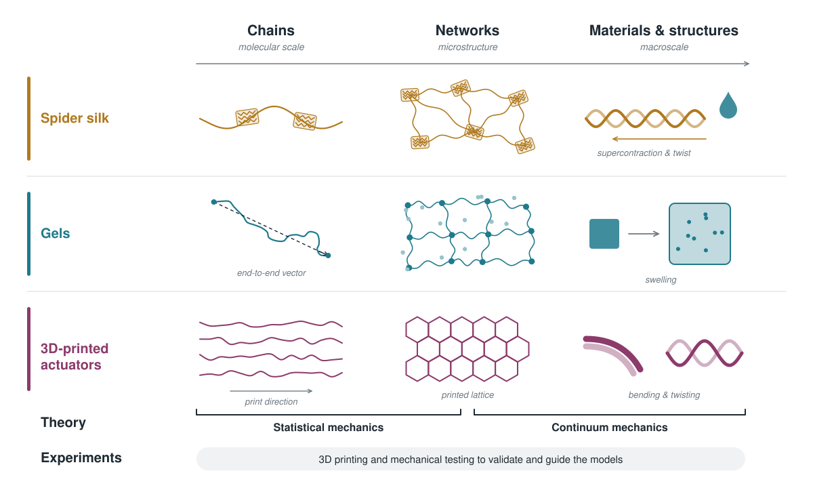

# Multiscale Mechanics Group

Welcome to the Multiscale Mechanics Group at the Technion. Our research lies at the intersection of mechanics, physics, and materials science. We combine theoretical modeling (statistical mechanics and continuum mechanics) with experimental techniques like 3D printing to understand and design the next generation of soft, responsive materials.

  
  

    <em>Our three material systems across length scales, and the theory and experiments that connect them.</em>
  

## What we work on

**[Mechanics of spider silk](/spider-silk/)**
How the molecular structure of silk proteins gives spider silk its exceptional combination of strength and toughness, and what that teaches us about designing new fibers.

**[Mechanics of gels](/gels/)**
How the polymer network and the solvent inside a gel govern its swelling, deformation, and response to external stimuli.

**[3D-printed composite structures and actuators](/composites/)**
Designing and printing lattice structures and soft actuators, including dielectric elastomers, whose shape and stiffness can be programmed.

## Publications

Our work appears in journals across mechanics, physics, and materials science. [Browse our publications](/publications/).

## Join us

We are looking for M.Sc. and Ph.D. students with a background in mechanical, materials, or electrical engineering. [Read about open positions and how to apply](/join-us/).